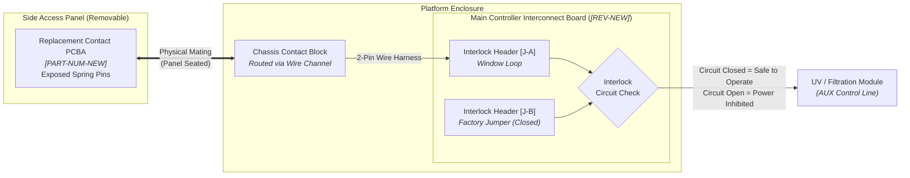

!!! info "Confidentiality and Scope"
    The following excerpt is anonymized and adapted from a field service manual. Proprietary product names, serial numbers, part numbers, PCB diagrams, and images have been removed to protect intellectual property.

## test header

more text

