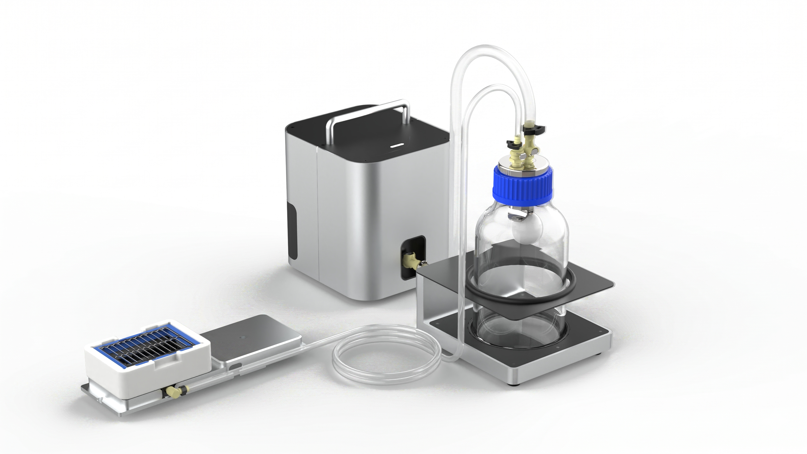
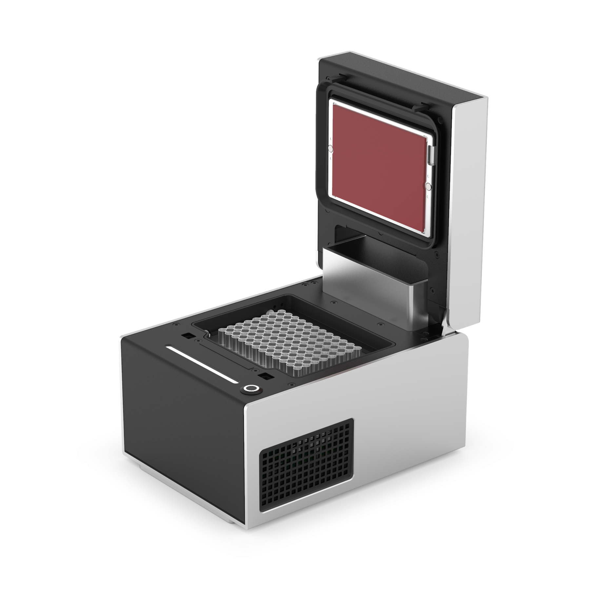

Writing samples and technical documentation for robotics and AdTech platforms.
<!---
- **Hardware:** Examples from robot instruction manuals.
- **Software:** Examples from API and G-Codes references for developers.
- **AdTech:** Examples from older documentation for ad serving systems.
--->

## :material-robot: Hardware documentation

Instruction manuals for liquid handling robots. These manuals feature my work as a contributing writer (Flex) primary author (OT-2).

-   
    [__Flex Instruction Manual :material-open-in-new:__](https://docs.opentrons.com/flex/)

    ---
    Featured sections:

    * [Installation and Relocation](https://docs.opentrons.com/flex/installation/)
    * [Maintenance and Service](https://docs.opentrons.com/flex/maintenance/)
    * [Command Line Operation Over SSH](https://docs.opentrons.com/flex/advanced-operation/command-line/)

-   
    [__OT-2 Instruction Manual :material-open-in-new:__](https://docs.opentrons.com/ot-2/)

    ---
    Featured sections:

    * [Calibration](https://docs.opentrons.com/ot-2/calibration/)
    * [System Description](https://docs.opentrons.com/ot-2/system-description/)
    * [Opentrons App](https://docs.opentrons.com/ot-2/opentrons-app/)

## :fontawesome-solid-file-code: Software documentation

The Vacuum Module API samples are a reference for scientists who want to write their own liquid-handling protocols. The G-code articles provide low-level machine instructions for developers integrating Opentrons hardware modules into third-party software and custom environments.

-   
    __Vacuum Moudle API Documentation__

    ---
    Featured sections:

    [Vacuum Module API Methods :material-open-in-new:](https://sandbox.docs.opentrons.com/docs-release-10.2.0/python-api/modules/vacuum/)  
    [Vacuum Module API Docstrings :material-open-in-new:](https://sandbox.docs.opentrons.com/docs-release-10.2.0/python-api/reference/vacuum/)

-   
    __Thermocycler G-Codes Documentation__

    ---
    Featured sections:

    [Thermocycler G-code Concepts :material-open-in-new:](https://docs.opentrons.com/thermocycler/g-code-concepts/)  
    [Thermocycler G-code Commands :material-open-in-new:](https://docs.opentrons.com/thermocycler/g-codes/)

---

## :material-server-network: Ad tech documentation

These are older AdTech writing samples that explain budget distribution, campaign performance, and device identity in an ad-serving system.

-   __Data Pipeline Flow__

    ---

    Explains how budget data moves through a distributed ad-serving stack.

    [Read Sample :octicons-arrow-right-24:](budget-updates.md)

-   __Resource Allocation__

    ---

    Explains how ad servers allocate budget based on campaign performance.

    [Read Sample :octicons-arrow-right-24:](budget-distribution.md)

-   __Fixing Delays With a Budget Update__

    ---

    Instructions on how to force a budget update to start ad delivery.

    [Read Sample :octicons-arrow-right-24:](budget-delay.md)

-    __Probabilistic Modeling__

    ---

    Explains how device graph confidence scores determine relationship strength between devices.

    [Read Sample :octicons-arrow-right-24:](confidence-scores.md)

---